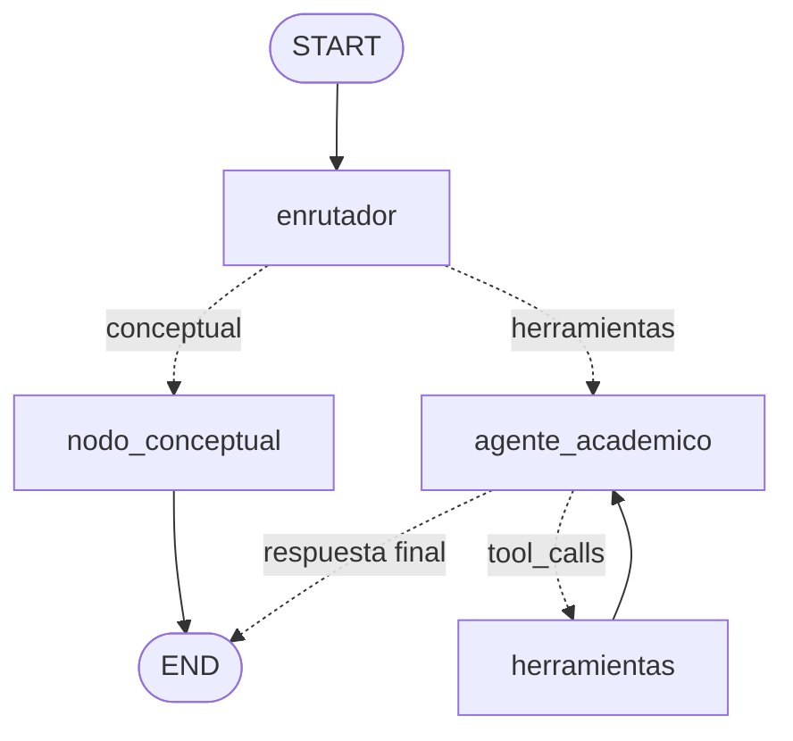

# Consultor Académico — Agente con LangGraph, RAG y observabilidad

Agente conversacional para estudiantes de la **Universidad Católica Luis Amigó**, desarrollado para la
asignatura **Sistemas Agénticos y Orquestadores de IA** (Unidad 3, actividad **P4 – Orquestación,
despliegue y observabilidad**). Docente: Alvaro Pérez Niño.

Consulta horarios, actividades, calendario académico, información de asignaturas y documentos
institucionales (RAG), recuerda la conversación y registra métricas de cada consulta.

## Demo desplegada

🔗 **URL:** [https://sistema-agentico-1.onrender.com](https://sistema-agentico-1.onrender.com)

> En el plan gratuito de Render la app se duerme tras 15 minutos sin uso; la primera visita puede tardar
> cerca de un minuto en despertar.

## Arquitectura

Grafo de estados cíclico (LangGraph) con cuatro nodos, 7 herramientas y memoria por `thread_id`:



| Componente | Implementación |
|---|---|
| **LangChain** | `ChatGoogleGenerativeAI` (Gemini Flash; el modelo se define en `GEMINI_MODEL`), `@tool`, salida estructurada con Pydantic |
| **LangGraph** | `StateGraph` con aristas condicionales, ciclo ReAct y `ToolNode` (`graph/`) |
| **Memoria** | `MemorySaver` (checkpointer) con un `thread_id` por conversación |
| **Estado** | `AcademicState`: mensajes (reducer `add_messages`), estudiante, ruta, traza de nodos, herramientas |
| **RAG** | Recuperación BM25 sobre `data/conocimiento/` (`rag/`), expuesta como la herramienta `consultar_base_conocimiento` |
| **Tools (7)** | `obtener_fecha`, `consultar_horario`, `consultar_actividades`, `priorizar_actividades`, `consultar_calendario_academico`, `consultar_informacion_asignatura`, `consultar_base_conocimiento` |
| **Observabilidad** | Tiempos, tokens, llamadas al modelo, herramientas y errores por turno (`observabilidad/`) |

### Estructura del proyecto

```
├── app.py                  # Interfaz Streamlit
├── config/settings.py      # Variables de entorno y parámetros operativos
├── core/                   # session.py (Streamlit), ejecutor.py (turno), errores.py
├── graph/                  # state.py, nodes.py, workflow.py
├── prompts/                # Prompts por nodo
├── tools/                  # 7 herramientas
├── rag/buscador.py         # Índice BM25 y fragmentación
├── observabilidad/         # Registro de métricas (JSONL)
├── ui/estilos.py           # Tema, CSS y componentes visuales
├── data/                   # horarios, actividades, calendario, asignaturas + conocimiento/
├── tests/                  # 70 pruebas automáticas
├── scripts/generar_evidencias.py
├── evidencias/             # Informes de pruebas, métricas y hallazgos
├── .streamlit/config.toml  # Tema de Streamlit
└── render.yaml             # Despliegue en Render
```

## Instalación y ejecución local

```bash
git clone https://github.com/LogicaLio/sistema_agentico.git
cd sistema_agentico
python -m venv .venv
.venv\Scripts\activate            # Windows  (Linux/Mac: source .venv/bin/activate)
pip install -r requirements.txt
```

Crea un archivo `.env` en la raíz (nunca lo subas a Git; ya está en `.gitignore`):

```
GEMINI_API_KEY=tu_api_key
GEMINI_MODEL=gemini-3.5-flash-lite
```

Obtén una clave gratuita en [Google AI Studio](https://aistudio.google.com/). Luego:

```bash
streamlit run app.py
```

Abre `http://localhost:8501`.

### Configuración opcional

| Variable | Por defecto | Para qué sirve |
|---|---|---|
| `MAX_MENSAJES_CONTEXTO` | 14 | Ventana deslizante del historial enviado al modelo |
| `RECURSION_LIMIT` | 12 | Tope de pasos del grafo por turno (evita bucles de herramientas) |
| `LLM_TIMEOUT` / `LLM_MAX_RETRIES` | 60 / 2 | Tiempo máximo y reintentos por llamada al modelo |
| `LOG_DIR` | `logs/` | Dónde se escribe `metricas.jsonl` |

## Datos y base de conocimiento (RAG)

- `data/*.json`: horarios, actividades, calendario y asignaturas. **Reemplázalos por tus datos reales.**
- `data/conocimiento/`: documentos `.md`, `.txt` o `.pdf` indexados automáticamente. Los que se incluyen
  son **de ejemplo** (el reglamento de `faq_ejemplo_reglamento.md` no es oficial). Agrega los tuyos y
  reinicia la app. Más detalles en `data/conocimiento/LEEME.md`.

## Interfaz

Tema azul institucional, encabezado, preguntas sugeridas, avatares, indicador de procesamiento, pie de cada
respuesta con tiempo, tokens y herramientas usadas, y mensajes de error claros. La barra lateral tiene tres
pestañas: **Perfil** (datos del estudiante, Thread ID y nueva conversación), **Métricas** (indicadores de la
sesión, uso de herramientas, tabla por consulta y descarga en CSV) y **Grafo** (último recorrido y diagrama).
El diseño se adapta a pantallas de celular.

## Pruebas

```bash
pip install -r requirements-dev.txt
python -m pytest -v
```

70 pruebas automáticas, sin API Key ni red (modelo simulado) y con sus propios datos en
`tests/datos_prueba/` (no dependen de tus datos reales de `data/`), que cubren las 7 herramientas, el RAG
(recuperación y PDF), el grafo completo (8 escenarios de rutas, memoria por hilo, límite de recursión,
respaldo del enrutador, ventana de contexto), las métricas, los errores y la **interfaz Streamlit completa**
con `AppTest`. La salida está en `evidencias/resultado_pytest.txt`.

Para generar el informe de evidencias:

```bash
python scripts/generar_evidencias.py --modo simulado   # sin API Key
python scripts/generar_evidencias.py --modo real       # con Gemini real (usa tu .env)
```

> **Alcance de cada modo.** El modo simulado valida la orquestación (rutas, herramientas, memoria, métricas,
> interfaz) de forma reproducible, pero no la calidad de las respuestas de Gemini. El modo real mide
> latencia y tokens verdaderos.

## Observabilidad y métricas

Cada turno registra una línea JSON en `logs/metricas.jsonl` con: pregunta, ruta, nodos recorridos,
llamadas al modelo, tokens de entrada y salida, tiempo del modelo y de las herramientas, latencia total,
herramientas usadas y errores. La barra lateral muestra las métricas de la sesión en vivo.

## Evidencias, hallazgos y ajustes

En `evidencias/`:

| Archivo | Contenido |
|---|---|
| `informe_pruebas_simulado.md` | Matriz de pruebas (esperado y obtenido), métricas y experimento de ventana de contexto |
| `informe_pruebas_real.md` | Lo mismo con Gemini real _(se genera con `--modo real`)_ |
| `hallazgos.md` | Hallazgos, acciones correctivas y verificación |
| `resultado_pytest.txt` | Salida detallada de las 70 pruebas |
| `capturas/` | Capturas de la interfaz en escritorio y celular (tomadas con el modelo simulado) |
| `metricas_*.csv` / `.jsonl` | Métricas por turno |

Ajustes principales: fragmentación por secciones y sinónimos en el RAG, ventana deslizante de contexto
(con Gemini real, −17 % de caracteres y −14 % de tokens de entrada enviados en el turno 8), límite de recursión, ruta de respaldo del
enrutador y mensajes de error amigables.

## Despliegue en Render

`render.yaml` define el servicio. En el dashboard de Render configura `GEMINI_API_KEY` como variable secreta.

- **Build:** `pip install -r requirements.txt`
- **Start:** `streamlit run app.py --server.port $PORT --server.address 0.0.0.0 --server.headless true`

## Límites del plan gratuito de Gemini

Cada modelo tiene sus propios límites de solicitudes por minuto (RPM) y por día (RPD), que cambian con el
tiempo. Consulta los vigentes de tu clave en <https://ai.dev/rate-limit>. Al 2 de noviembre de 2026,
`gemini-3.5-flash-lite` permitía 15 RPM y 500 RPD, mientras que `gemini-3.8-flash` solo 5 RPM y 20 RPD,
que se agotan con 5 a 8 preguntas (cada una usa de 2 a 4 llamadas al modelo). Si cambia el modelo, ajusta
`GEMINI_MODEL`. Para ejecutar las evidencias reales con otro ritmo, usa `EVID_LLAMADAS_POR_MINUTO`.

## Limitaciones conocidas

- `MemorySaver` guarda la memoria en el proceso: se pierde si Render reinicia o duerme el servicio.
  Para persistencia real se puede migrar a un checkpointer con base de datos (por ejemplo SQLite o Postgres).
- En Render gratuito el disco es efímero: `logs/metricas.jsonl` se pierde al reiniciar. Las métricas de la
  sesión siguen visibles en la barra lateral y se pueden descargar en CSV.
- El RAG es léxico (BM25): no entiende sinónimos más allá de los definidos en `rag/buscador.py`.
  Una evolución natural es usar embeddings y una base vectorial.
- Los datos y documentos incluidos son de ejemplo.
